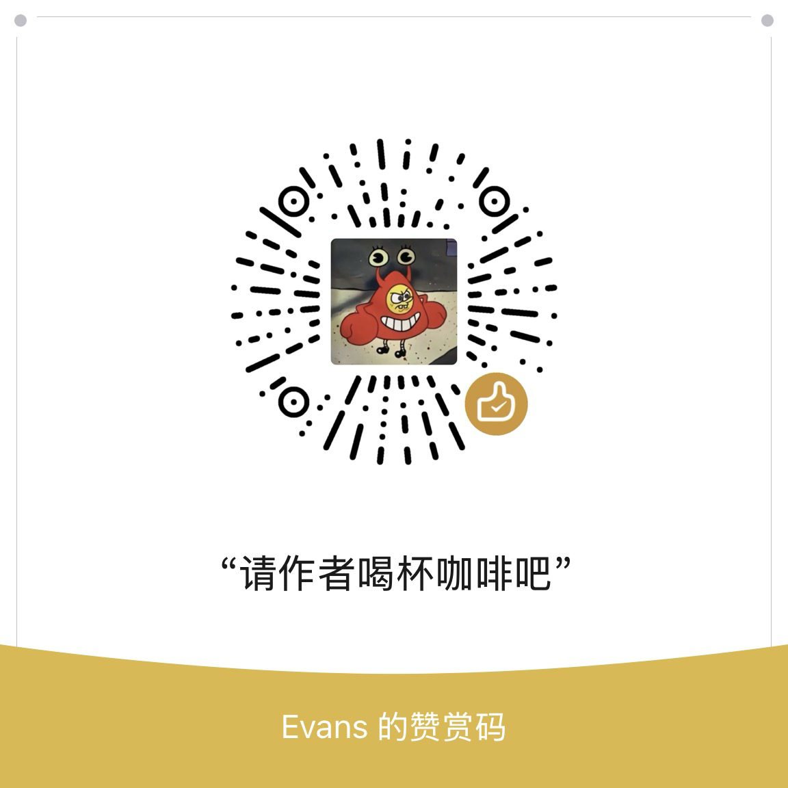

<p align="right">简体中文 · <a href="README.en.md">English</a></p>

<div align="center">


# Maclean

**关掉屏幕，或进入清洁模式。**

一款常驻菜单栏的 macOS 小工具，提供息屏和清洁两个功能。


[](LICENSE)
[](https://github.com/EathonEvans/maclean/releases)

[下载](https://github.com/EathonEvans/maclean/releases) · [产品主页](https://maclean.ethon-link.work) · [问题反馈](https://github.com/EathonEvans/maclean/issues)

</div>

## 功能

**息屏**

关闭所有显示器，不锁定用户会话，也不让 Mac 进入睡眠。移动鼠标或按下键盘即可恢复显示。

**清洁模式**

所有显示器显示黑色画面，并屏蔽键盘输入，避免清洁时误触。

退出时，将鼠标停在任意屏幕中央的提示卡片上，保持设定的时长（默认 1.5 秒，可在设置中调整）。卡片上会显示退出进度；移开鼠标后计时重置。

设置项：登录时启动、退出悬停时长（0.5–5 秒）。

## 安装

从 [Releases](https://github.com/EathonEvans/maclean/releases) 下载 DMG 或 PKG，安装到 `/Applications`。要求 macOS 14 或更高版本，支持 Intel 和 Apple Silicon。

应用尚未经过 Apple 签名和公证，首次打开时可能被 Gatekeeper 拦截：

- **macOS 15 及以上**：打开 Maclean 后，在「系统设置 → 隐私与安全性」中选择「仍要打开」。
- **macOS 14**：右键点击 Maclean，选择「打开」，再确认打开。

也可以在终端执行：

```bash
xattr -dr com.apple.quarantine /Applications/maclean.app
```

## 辅助功能权限

清洁模式需要辅助功能权限，息屏功能不需要。

首次启动清洁模式时，按提示前往「系统设置 → 隐私与安全性 → 辅助功能」，启用 Maclean 后重试。未授权时，清洁模式无法启动。

## 隐私

Maclean 不联网、不要求登录，也不包含统计或广告。

清洁模式下，键盘输入会被丢弃，不读取按键内容。鼠标位置仅用于判断是否进入退出热区。日志使用 macOS 统一日志，不记录按键内容。

## 常见问题

<details>
<summary><strong>息屏会锁屏或让 Mac 睡眠吗？</strong></summary>

不会。息屏只关闭显示器，不锁定用户会话，也不让 Mac 进入睡眠。需要离开电脑时，请使用系统锁屏（⌃⌘Q）。
</details>

<details>
<summary><strong>清洁模式怎么退出？</strong></summary>

将鼠标停在任意屏幕中央的提示卡片上，保持设定的时长（默认 1.5 秒）即可退出。移开鼠标会重置计时。清洁模式最长持续 10 分钟，之后自动退出。
</details>

<details>
<summary><strong>清洁模式会读取键盘输入吗？哪些键不会被屏蔽？</strong></summary>

不会。清洁模式下的按键会被丢弃，不读取字符内容。

主键盘区、修饰键组合、系统快捷键与功能键行（亮度/音量/媒体键，经系统定义事件通道一并屏蔽）全部失效。**唯一例外**：Touch ID/电源键等硬件按键（不经事件系统，任何软件方案均无法拦截）。
</details>

<details>
<summary><strong>怎么卸载？</strong></summary>

退出 Maclean，将 `/Applications/maclean.app` 移至废纸篓。如果启用了登录时启动，请先在「系统设置 → 通用 → 登录项」中移除。
</details>

<details>
<summary><strong>为什么不上架 App Store？</strong></summary>

当前实现涉及键盘输入拦截和显示器控制，采用 DMG / PKG 独立分发。
</details>

## 支持开发者

Maclean 免费开源。如果它对你有帮助，欢迎请作者喝杯咖啡，或在 GitHub 点个 Star。

<p align="center">
  
  &nbsp;&nbsp;&nbsp;&nbsp;
  
</p>
<p align="center"><sub>微信（左） · 支付宝（右）</sub></p>

## 许可证

[MIT](LICENSE) © 2026 EathonEvans
