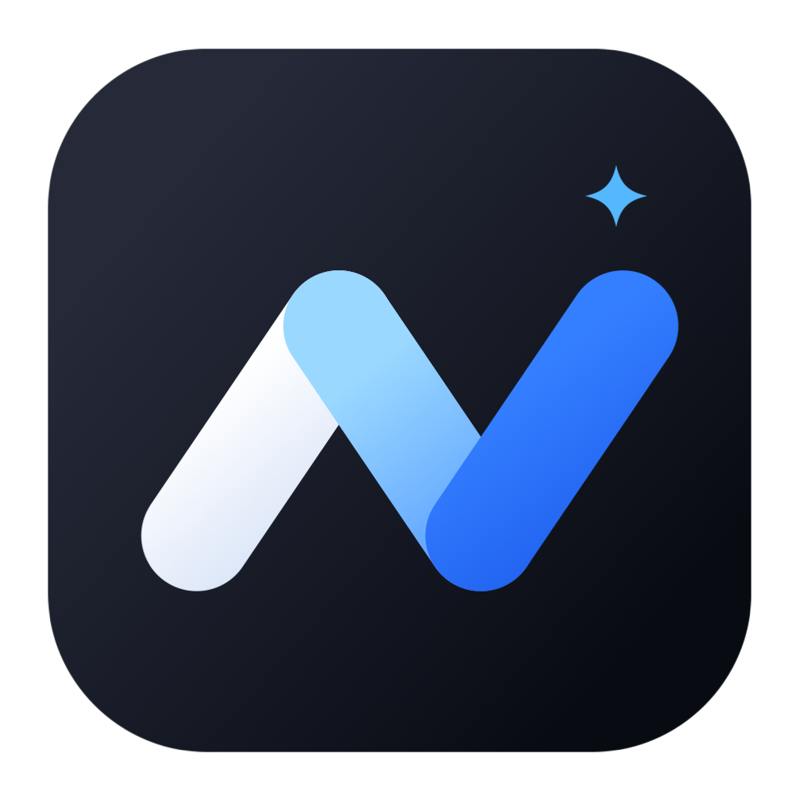
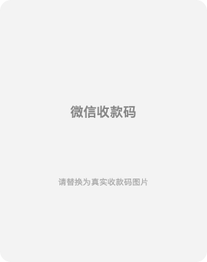
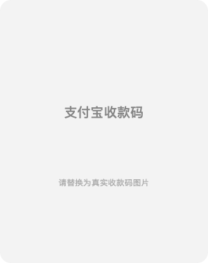

<div align="center">



# maclean

**极简 macOS 菜单栏工具：一键显示器休眠 · 清洁模式**

[](LICENSE)
[]()
[]()
[]()

[产品主页](https://eathonevans.github.io/maclean/) · [下载](../../releases) · [问题反馈](../../issues)

</div>

---

## 它做什么

只有两个动作，但每个都足够可靠：

| | 功能 | 说明 |
|---|---|---|
| 🖥 | **显示器休眠** | 一键关闭显示器。不锁屏、不整机睡眠、不要求重新认证、不修改系统睡眠设置 |
| ✨ | **清洁模式** | 全屏纯黑 + 屏蔽全部键盘输入，安心擦屏幕/擦键盘。屏幕中央常驻玻璃卡片提示，**悬停提示框 1.5 秒**退出 |

**多显示器**：每块屏幕独立黑屏窗口与热区，插拔热切换，镜像去重。

**隐私**：不记录键盘内容、不保存鼠标轨迹、无网络、无账号、无云端。

## 为什么这样设计

- **键盘全屏蔽，无例外**——擦键盘时任何按键都不该有反应，包括可能的误触发组合
- **热区就是提示框本身**——HUD 写着"悬停即可退出"，看见的即悬停的，不需要猜热区在哪
- **多重安全兜底**——EventTap 在专用线程创建（主线程永不阻塞）、10 分钟时长上限、tap 失效自愈、主线程看门狗。清洁模式永远不可能把系统锁死
- **显示器休眠 ≠ 系统睡眠 ≠ 锁屏**——严格区分三者，休眠只关显示器，唤醒即恢复

## 从源码构建

依赖：macOS 14+、Xcode、[xcodegen](https://github.com/yonaskolb/XcodeGen)

```bash
git clone https://github.com/EathonEvans/maclean.git
cd maclean
make assets   # 从 assets/logo.svg 生成 AppIcon.icns 与菜单栏模板图标
make build    # 编译，产物在 build/maclean.app
make test     # 运行单元测试
make run      # 构建并启动
make package  # 生成 dist/ 下的 DMG 与 PKG 安装包
```

首次运行：**系统设置 → 隐私与安全性 → 辅助功能 → 允许 maclean**（清洁模式屏蔽键盘需要，息屏不需要）。

## 安装

从 [Releases](../../releases) 下载：

- **DMG**：挂载后拖入 Applications
- **PKG**：安装器引导装到 /Applications

未做公证（无 Apple 开发者账号成本），首次打开需**右键 → 打开**。建议装到 `/Applications`（登录启动与权限记忆更稳定）。

## 权限与隐私

| 功能 | 权限 | 说明 |
|---|---|---|
| 显示器休眠 | 无 | `pmset displaysleepnow`，不持有电源断言 |
| 清洁 · 黑屏/热区 | 无 | 全局鼠标轮询定位，不监听不记录轨迹 |
| 清洁 · 键盘屏蔽 | 辅助功能 | CGEventTap 过滤 keyDown/keyUp/flagsChanged，**不读取任何字符内容** |
| 登录启动 | 可选 | SMAppService，可在系统设置中管理 |

日志只记录状态与错误码。键盘事件在 tap 回调中即吞即弃，不落盘、不上传。

## 已知限制

- 不承诺拦截 Secure Input、系统安全界面与硬件功能键（普通 App 的能力边界）
- 单次清洁最长 10 分钟自动退出；EventTap 被系统禁用时自动重启用或安全退出
- 无快捷键退出通道（键盘全屏蔽，无例外）；主线程看门狗保证系统不可能被锁死
- 未公证分发：其他机器首次打开需右键 → 打开

## 技术架构

SwiftUI（菜单面板/设置/HUD）+ AppKit（全屏窗口/状态项）+ CoreGraphics（Quartz 事件/显示器标识），无第三方依赖。

几个值得一看的实现：

- **EventTap 专用线程**——tap 创建在专用线程，主线程有界等待 2 秒回滚，杜绝主线程被同步系统调用阻塞（`KeyboardEventMonitor`）
- **看门狗**——清洁期间后台 ping 主线程，失联约 1 分钟强制退出进程，系统不可能被锁死（`CleaningManager.startWatchdog`）
- **事务式进入/退出**——先准备后展示、统一 `exitCleaningMode(reason:)`、显示器变化热同步（`CleaningManager`）
- **图标全自动化**——从一份品牌 SVG 生成 AppIcon.icns、菜单栏 Template 图标、菜单项图标（`scripts/generate-assets.swift`）

## 支持开发者

maclean 完全免费开源。如果它帮你省了时间，欢迎请作者喝杯咖啡 ☕

<p align="center">
  
  &nbsp;&nbsp;&nbsp;&nbsp;
  
</p>

也可以点个 ⭐ Star，一样是鼓励。

## License

[MIT](LICENSE) © 2026 EathonEvans
